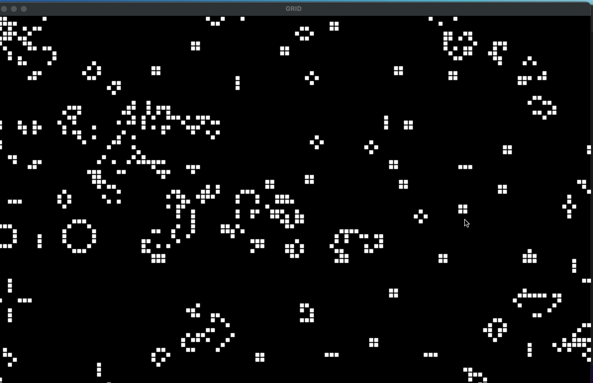
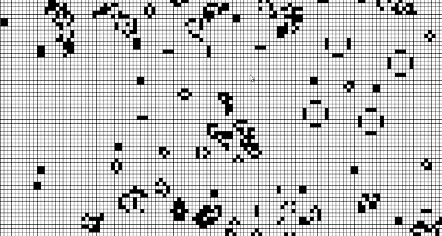
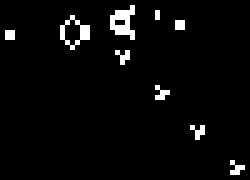

# Conway's Game of Life
Implémentation du **Jeu de la vie de Conway** en JavaScript avec HTML5 Canvas.

## Présentation
Le Jeu de la vie (*Game of Life*) est un automate cellulaire imaginé par le mathématicien britannique John Horton Conway en 1970.

Il s'agit d'un jeu sans joueur : son évolution est entièrement déterminée par son état initial. À partir d'une grille de cellules vivantes et mortes, chaque génération est calculée en fonction de l'état des huit cellules voisines.

Malgré la simplicité de ses règles, le système peut produire des comportements complexes et des motifs surprenants.

## Exemples

Jeu de la vie

Gospers glider gun (canons à planeurs)

## Règles du jeu
Chaque cellule possède huit voisines : horizontalement, verticalement et en diagonale.

À chaque génération, son état est déterminé selon les règles suivantes :
| État actuel | Voisines vivantes | Nouvel état |
| ----------- | ----------------- | ----------- |
| Morte       | 0, 1 ou 2         | Morte       |
| Morte       | **3**             | **Vivante** |
| Morte       | 4 à 8             | Morte       |
| Vivante     | 0 ou 1            | Morte       |
| Vivante     | **2 ou 3**        | **Vivante** |
| Vivante     | 4 à 8             | Morte       |

### Pourquoi ces règles ?
On leur donne généralement quatre noms :

1. **Naissance** : une cellule morte avec exactement 3 voisines vivantes devient vivante.
2. **Survie** : une cellule vivante avec 2 ou 3 voisines vivantes reste vivante.
3. **Sous-population** : une cellule vivante avec moins de 2 voisines vivantes meurt.
4. **Surpopulation** : une cellule vivante avec plus de 3 voisines vivantes meurt.

Toutes les cellules évoluent simultanément.

## Commandes de la simulation
| Touches du clavier | Action                                |
| ------------------ | ------------------------------------- |
| Espace             | Pause / Jouer                         |
| Flèche droit       | Ralentir                              |
| Flèche gauche      | Accélérer                             |
| Flèche bas         | Réinitialiser la vitesse              |
| I                  | Afficher la vitesse de génération     |
| P                  | Afficher le canon à planeurs          |
| R                  | Reset la génération                   |
| 0                  | Reset la génération et le taux de vie |

## Technologies utilisées
- **JavaScript** : logique du jeu et gestion de la simulation.
- **HTML5 Canvas** : rendu graphique de la grille et des cellules.

## Fonctionnalités
- [x] Génération d'une grille adaptée à la taille de l'écran.
- [x] Résolution configurable.
- [x] Calcul des générations.
- [x] Simulation en temps réel.
- [x] Contrôle de la simulation (lecture et pause).
- [ ] Modification manuelle de l'état des cellules.
- [x] Réinitialisation de la grille.
- [x] Gestion de la vitesse de simulation.

## Lancement du projet
Le projet utilise JavaScript côté navigateur. Il suffit d'ouvrir le fichier HTML principal avec un serveur local

## Objectif
Ce projet est réalisé dans un but personnel afin d'expérimenter les automates cellulaires, la programmation JavaScript et le rendu graphique avec Canvas.

## Références
- [Conway's Game of Life — Wikipedia](https://en.wikipedia.org/wiki/Conway%27s_Game_of_Life)